<h1 align="center">Hyperparameter Optimizer</h1>

<p align="center">
  <em>Black-box hyperparameter optimization built from scratch: random and quasi-random search, a Tree-structured Parzen Estimator, and Gaussian-process Bayesian optimization with Expected Improvement.</em>
</p>

<p align="center">
  <a href="https://github.com/adeoluo/hyperparameter-optimizer/actions/workflows/ci.yml"></a>
  
  
  
  
  
</p>

---

## Motivation

Tuning hyperparameters by hand or by grid search wastes most of the budget on configurations
that were never going to work. Model-based optimization fixes this: it **learns from the
trials it has already run** to propose the next one, reaching a good configuration in far
fewer evaluations. This project builds that idea **from first principles** - the search
space, the samplers, and even the linear algebra behind the Gaussian process - with **zero
runtime dependencies** and a deterministic, offline test suite.

## Architecture

<p align="center">
  
</p>

A **Study** runs an ask/evaluate/tell loop: a **sampler** proposes a point in a normalized
unit cube, the **search space** decodes it into a concrete configuration, the objective is
evaluated, and the completed trial conditions the next proposal. See the [ADRs](docs/adr/)
for the key design choices.

## Samplers

- **Random** and **Sobol** (a Halton-style low-discrepancy sequence) - space-filling
  baselines; quasi-random covers the space more evenly than independent sampling.
- **TPE** (Tree-structured Parzen Estimator) - splits trials into a good and a bad group,
  fits a Parzen-window density to each per dimension, and proposes the candidate maximizing
  the good/bad density ratio (which is monotonic in Expected Improvement).
- **Gaussian process** - a from-scratch GP regressor (squared-exponential kernel, Cholesky
  solve) with the **Expected Improvement** acquisition, the canonical Bayesian-optimization
  method.

All samplers share one `Sampler` protocol and one normalized search space, so continuous,
log-scaled, integer, and categorical parameters are handled uniformly.

## Results

> Reproduce with `python -m hyperparameter_optimizer evaluate`. Mean **simple regret** (best
> value found minus the known global optimum) over three seeds and 40 trials; lower is better.

| Sampler | sphere | branin | ackley | rastrigin |
|---|---:|---:|---:|---:|
| random | 0.347 | 1.601 | 2.279 | 3.992 |
| sobol | 0.913 | 1.110 | 3.312 | 7.569 |
| tpe | 0.140 | 0.426 | 3.144 | 5.259 |
| **gp** | **0.011** | **0.045** | **1.127** | 4.630 |

On the smooth objectives the **Gaussian process reaches a near-optimal solution** where
random search is still far away - for example Branin regret **0.045 vs 1.601**, a **35x**
improvement in the same budget. The highly multimodal Rastrigin function remains hard for
every method, which is the honest, expected result and is discussed in [limitations](#limitations).

## The sample-efficiency vs compute tradeoff

From `benchmarks/benchmark.py` on Branin (40 trials):

| Sampler | time | regret |
|---|---:|---:|
| random | 0.1 ms | 4.02 |
| sobol | 0.1 ms | 1.11 |
| tpe | 14 ms | 0.17 |
| gp | 139 ms | 0.016 |

This is the central tradeoff of Bayesian optimization in one table: the Gaussian process
spends roughly **a thousand times more compute per trial** to reach roughly **250 times
lower regret**. When each objective evaluation is expensive (training a model), that trade is
overwhelmingly worth it; when evaluations are nearly free, cheaper samplers win.

## Quickstart

```bash
git clone https://github.com/adeoluo/hyperparameter-optimizer.git && cd hyperparameter-optimizer
make setup                    # install dev tooling + pre-commit hooks
make all                      # lint + type-check + test

python -m hyperparameter_optimizer evaluate                      # all samplers vs all benchmarks
python -m hyperparameter_optimizer optimize branin --sampler gp  # one run, with the best config
```

Use the library directly on your own objective:

```python
from hyperparameter_optimizer import SearchSpace, LogUniform, IntUniform, Study, TPESampler

space = SearchSpace([LogUniform("learning_rate", 1e-4, 1e-1), IntUniform("depth", 1, 8)])
study = Study(space, TPESampler(seed=0))


def objective(config: dict[str, object]) -> float:
    return train_and_return_validation_loss(config)  # lower is better


result = study.optimize(objective, trials=40)
print(result.best_configuration, result.best_value)
```

Or drive it yourself with the ask/tell interface:

```python
trial = study.ask()
study.tell(trial, objective(trial.configuration))
```

## Running the service

A dependency-free HTTP service exposes the optimizer as a production-style JSON API:

```bash
python -m hyperparameter_optimizer serve --port 8000

curl localhost:8000/health
curl -s -X POST localhost:8000/optimize -d '{"benchmark": "branin", "sampler": "gp", "trials": 40}'
curl localhost:8000/evaluate
```

`POST /optimize` returns the best value, simple regret, best configuration, and the
convergence curve. See the [operations guide](docs/OPERATIONS.md), the
The service also exposes `GET /ready` (readiness) and `GET /metrics` (per-route request, error, and latency metrics in Prometheus text format).
[scaling and tradeoffs](docs/SCALING.md) document, and the [case study](docs/CASE_STUDY.md)
on tuning a model under a fixed trial budget. A production-style stress benchmark
(`uv run python benchmarks/stress.py`) reports throughput and p50/p95/p99 latency.

## Components

- **space** - the normalized search space and its parameter types.
- **samplers** - random, Sobol, TPE, and Gaussian-process samplers behind one protocol.
- **linalg** - a dependency-free Cholesky solver for the Gaussian process.
- **study** - the ask/tell optimization loop and convergence tracking.
- **objectives** - standard black-box benchmark functions with known optima.
- **evaluation** - simple-regret comparison across samplers and benchmarks.

## Design decisions

- **A normalized unit cube.** Every sampler works in `[0, 1)^d` and the space decodes
  proposals, so one optimizer handles mixed parameter types.
  ([ADR-0002](docs/adr/0002-normalized-search-space.md))
- **A from-scratch Gaussian process.** Implementing the kernel and the Cholesky solve
  directly keeps the project dependency-free and makes the Bayesian-optimization machinery
  fully inspectable. ([ADR-0003](docs/adr/0003-from-scratch-gaussian-process.md))

## Responsible AI

- **Model card:** [docs/MODEL_CARD.md](docs/MODEL_CARD.md)
- **Data card:** [docs/DATA_CARD.md](docs/DATA_CARD.md)
- **Threat model:** [docs/THREAT_MODEL.md](docs/THREAT_MODEL.md)

## Limitations

- The Gaussian process uses a fixed length scale rather than marginal-likelihood
  optimization; a learned length scale would improve it further.
- Highly multimodal objectives (Rastrigin) defeat all of the samplers at this budget; a
  restart strategy or a longer budget is needed, which the numbers show honestly.
- The benchmark objectives are low-dimensional; very high-dimensional spaces need structural
  assumptions the reference does not make.

## Roadmap

- [ ] Marginal-likelihood length-scale fitting for the Gaussian process
- [ ] Constant-liar batching for parallel proposals
- [ ] A model-training objective backed by the evaluation-harness project

## License

[MIT](LICENSE). Part of an artificial intelligence engineering portfolio by
[adeoluo](https://github.com/adeoluo).
